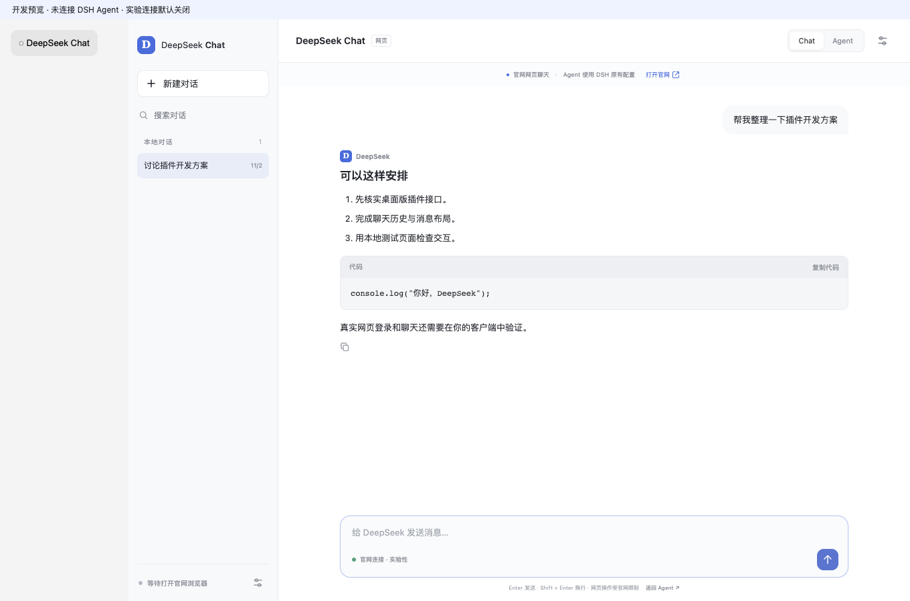

# DSH Chat 面板（预览版）

面向 DeepSeek Harness Mac 桌面版的 ChatGPT 风格插件。当前交付版本：`0.1.0-preview.3`。

已核实本机安装包 **DSH Desktop 0.2.1-rc.5 / macOS arm64** 的正式插件入口。此交付是可构建、可安装的实验版源码包，不代表已经在你的实际 DSH 窗口中完成网页登录和端到端聊天验证。

## 已实现

- 独立主面板、侧边栏入口、本地历史搜索、新建/删除本地对话。
- 消息布局、Markdown、表格、代码块及复制、多行输入、中文输入法处理。
- 可见 Chrome 页面连接、网页内容逐步刷新、停止按钮和未完成状态。
- 每条历史保存对应官网会话地址，续聊前检查地址和网页消息；不能确认时停止。
- Chat / Agent 切换：`Agent` 按钮返回原生 DSH 会话；不改模型、API Key、额度来源或 Agent 工具。
- 网页连接默认关闭，每次宿主重启后需重新启用。未连接时可直接打开官网。

## 免费网页连接的真实边界

官方 API 文档提供的是需要 API Key 的模型接口；这里**没有把官网账号当作官方免费 API**。参考项目 [xmuwenxiang/dsh-web-chat](https://github.com/xmuwenxiang/dsh-web-chat) 提供了研究起点，但本插件采用新的正式面板注册方式和独立的实验 DOM 连接，不复用其网络流捕获、Agent 工具、系统提示或可能消耗额度的摘要转交。

实验连接只打开可见 Chrome，并操作官网页面的输入、发送和停止控件，读取已经显示的消息。不请求私有聊天端点，不拦截网页网络流，不提取 Cookie、令牌、密码，不伪装浏览器或处理验证码。遇到登录、验证、限流或无法识别的页面会暂停；不重试、不回退到付费模型。需要你在官网自行处理。网页可以拒绝自动化，这时请直接使用官网。

插件不收集或写入账号密码。专用 Chrome 配置关闭密码保存功能；Chrome 为维持网页登录可能保存自己的 Cookie/站点存储，插件不读取它们。仅在实验连接中登录的会话使用该专用配置，与你日常 Chrome 配置分开。

## 从 GitHub 安装

公开仓库：[cschensheng1-web/dsh-chatgpt-panel](https://github.com/cschensheng1-web/dsh-chatgpt-panel)。在 DSH 插件管理页的 GitHub 来源中填入：

```text
github:cschensheng1-web/dsh-chatgpt-panel
```

若已经安装与 Mac App 配套的 `dsh` 命令，也可完全退出 DSH 后执行：

```sh
dsh plugin --profile desktop add github:cschensheng1-web/dsh-chatgpt-panel
```

`lib/client.js` 已提交，GitHub 安装不需要先构建。该安装入口尚未在真实 Mac Desktop profile 验证；当前通过的是本地目录安装与隔离 DSH Web 测试。完成安装后仍需按下方步骤自行登录官网。仅使用命令行 Web 宿主时，将 profile 改为 `web`。

## 本地目录安装

1. 解压交付的 ZIP 到一个固定目录，例如 `~/Documents/DSH-Plugins/dsh-chatgpt-panel`。不要移动到应用程序包内部。
2. 在 DSH 的插件管理页面选择“添加插件”，安装来源选择本地目录，填入解压后**含 package.json 的 dsh-chatgpt-panel 文件夹绝对路径**。保持网络可用，安装器需要获取公开的 `playwright-core` 依赖。不要输入 `github:xmuwenxiang/dsh-web-chat`，那是不同的上游插件。
3. 启用后按 DSH 提示重新加载。侧边栏出现 `DeepSeek Chat`。
4. 点击“打开 DeepSeek 官网”可直接使用官网。要测试自定义面板聊天，打开“连接设置”，勾选实验连接，再点击“打开 Chrome 登录窗口”。
5. 在 Chrome 的官网页面自行登录。不要向插件或本对话提供密码、验证码或登录令牌。保持 Chrome 可见。
6. 新建对话，发送一条短消息。确认官网与面板显示一致，再测试历史续聊和停止。遇到不确定发送状态，先到官网核对，勿重复发送。

若通过 DSH 的 **Manage dsh Command…** 安装了与 App 配套的命令，可在完全退出 DSH 后使用：

```sh
dsh plugin --profile desktop add '/absolute/path/to/dsh-chatgpt-panel'
```

桌面版的 DSH_HOME 和运行时与另一套全局 CLI 可能不同。优先使用桌面插件管理页，避免装进另一个配置。仅使用命令行 Web 宿主时，才将上述命令的 profile 改为 `web`。该包已经包含构建好的 `lib/client.js`，普通安装不需要先构建。

## 本地开发与预览

安装 Node.js 22+ 和 Google Chrome 后，在插件目录运行：

```sh
npm ci --ignore-scripts
npm run check
npm run preview
```

访问预览服务打印的本机地址。预览中 Agent 是明确标识的占位，不能操作实际 DSH；实验连接仍默认关闭。按 Ctrl+C 关闭服务。

`npm run build` 更新浏览器插件包；修改源码后必须重新构建再安装。`npm test` 使用本地夹具和隔离临时目录，不登录官网，也不发送真实消息。

## 数据、恢复与卸载

- 插件数据：`$DSH_HOME/plugin-data/dsh-chatgpt-panel`；若没有 DSH_HOME，则为 `~/.dsh/plugin-data/dsh-chatgpt-panel`。
- `chats.json` 是明文聊天历史，文件权限 0600、目录权限 0700；请按聊天内容的敏感程度保管。删除面板记录只删除本地历史，不删除官网历史。
- `browser-profile` 是专用 Chrome 数据。退出浏览器并停用插件后可删除它以清除本地网页登录状态；不要上传或分享该目录。
- 发生错误/中断时保留部分回复和未确认状态。当前预览版不提供自动恢复或重复发送，以防发送到错误会话。你可在官网继续，或新建一条插件对话。
- 卸载：在 DSH 插件管理中禁用/移除本插件。需要彻底清理时，退出专用 Chrome 后自行删除上述插件数据目录。不要删除整个 DSH_HOME。

## 连接提示

如果启用实验连接时提示“仅允许本机 DSH 同源页面访问”，请更新至 `0.1.0-preview.2` 或更新版本并重启 DSH。旧版本错误拒绝了桌面版转发的请求。此修复只处理本地请求，官网登录和真实聊天仍需在本机验证。

如果看到“专用 Chrome 窗口仍在使用中”，请使用 `0.1.0-preview.3` 或更新版本。新版本会复用已有浏览器上下文，在退出完成后才允许重开；外部占用时只提示关闭插件的专用窗口，不删除锁文件或清除登录数据。旧版留下的长启动日志会在面板中转换为简短提示。已中断的消息不会自动重发，请先在官网核对。

## 更新会不会影响使用？

可能。DSH 插件接口和 DeepSeek 网页结构是两条独立的兼容性边界。正式 slots 接口减少了布局更新带来的风险；网页 DOM 连接仍可能随页面改版失效。失败只应表现为 Chat 提示/停止，Agent 仍按 DSH 原规则使用其原有配置和额度。

升级前关闭实验连接并备份插件历史；升级后先检查入口、切回 Agent、打开官网，再测试一条短消息。若失败，禁用插件后继续使用原生 DSH。新版本需重新验证，不承诺永久兼容。

详细证据见 [兼容性研究](docs/COMPATIBILITY.zh-CN.md)，验证结果与人工测试清单见 [测试说明](docs/TESTING.zh-CN.md)。

## 界面示例

下图来自本地测试夹具，尚未连接真实官网或 DSH Agent。


